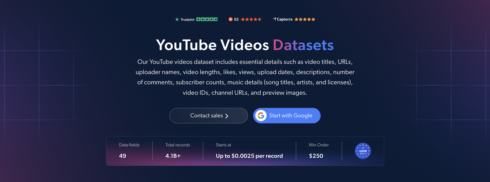

# YouTube 视频数据集样本

<h2>包含 1,000 个 YouTube 视频的示例数据集</h2>

<a href="https://www.bright.cn/products/datasets/youtube/videos">
   
</a>

包含 1,000 个公开视频的 YouTube 视频数据集样本。该数据集使用 <b>Bright Data API</b> 提取。

<h2>数据集中包含的部分数据点：</h2>

* ```url```：YouTube 视频页面的 URL
* ```video_id```：每个视频的唯一标识符
* ```title```：视频标题
* ```description```：视频描述
* ```date_posted```：视频发布日期
* ```video_length```：视频时长（秒）
* ```views```：视频观看次数
* ```likes```：视频获得的点赞数
* ```num_comments```：YouTube 显示的评论数量，包括回复
* ```youtuber```：发布视频的频道账号
* ```youtuber_id```：频道的唯一标识符
* ```channel_url```：YouTube 频道的 URL
* ```subscribers```：频道订阅者数量
* ```verified```：频道是否已认证
* ```preview_image```：视频预览图的 URL
* ```post_type```：内容类型，例如普通视频或 YouTube Short
* ```category```：分配给视频的 YouTube 内容类别
* ```hashtags```：视频标题或描述中的话题标签
* ```tags```：与视频相关的标签
* ```music```：视频中识别出的音乐信息
* ```transcript```：根据可用字幕轨道生成的纯文本转录稿
* ```formatted_transcript```：带时间戳的转录片段
* ```transcript_language```：可用的字幕和转录语言
* ```chapters```：创作者定义的章节标题和开始时间
* ```is_sponsored```：YouTube 是否显示声明付费内容的叠加提示
* ```license```：视频声明许可证的 URL

以及更多数据。

这是“YouTube 视频（公开数据）”数据集的示例子集，该完整数据集包含超过 <b>4,100,000,000 条视频记录</b>。

可用的数据集文件格式：<b>JSON、NDJSON、JSON Lines、CSV 或 Parquet。文件还可选择压缩为 .gz 格式</b>。

数据集交付方式选项：<b>电子邮件、API 下载、Webhook、Amazon S3、Google Cloud 存储、Google Cloud PubSub、Microsoft Azure、Snowflake、SFTP</b>。

更新频率：<b>一次性、每日、每周、每月、每季度、每半年或自定义</b>。

可在已提取数据点的基础上添加数据增强：<b>按需提供。</b>

<b>[获取完整的 YouTube 视频数据集](https://www.bright.cn/products/datasets/youtube/videos)</b>。

<a href="https://www.bright.cn/products/datasets/youtube/videos">
</a>

<h2>YouTube 视频数据集有哪些使用场景？</h2>

<h3>1. 内容表现分析</h3>
创作者和营销人员使用 YouTube 视频数据集，比较不同主题、类别和视频时长下的观看次数、点赞数和评论数。这些指标有助于识别表现最佳的内容，并为未来的视频策略提供参考，而不必仅依赖频道订阅者数量。

<h3>2. 竞争情报</h3>
品牌会分析竞争对手的发布日期、视频主题、标签和表现指标，以了解其内容策略。比较不同频道的上传频率和互动情况，有助于发现内容缺口和实现差异化的机会。

<h3>3. 转录稿和主题研究</h3>
研究人员通过分析视频转录稿、描述和话题标签来梳理主题、跟踪品牌提及并识别反复出现的主题。带时间戳的转录稿和章节标记有助于定位视频中的相关片段，并支持构建可搜索的内容库。

<h2>为学术研究人员和 NGO 免费提供网页爬虫工具和数据集</h2>

Bright Initiative 公益计划为顶尖学术院系和研究人员，以及致力于推动各类环境和社会事业的 NGO 与 NPO，提供 Bright Data 的 <b>[网页爬虫工具 API](https://www.bright.cn/products/web-scraper)</b> 和 <b>[即用型数据集](https://www.bright.cn/products/datasets)</b>。你可以在<b>[此处](https://brightinitiative.com)</b>提交申请。
